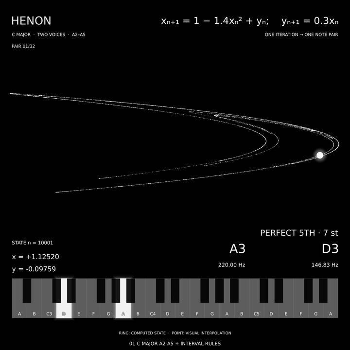

# HENON SPEAKS MUSIC — A2-A5



The GIF is a silent 14-second preview; the generated MP4 includes stereo piano.

One Julia file generates one 1080 x 1080 film comparing three sonification
rules in the A2-A5 register. The film lasts exactly 182 seconds (3:02) at
24 FPS. Each part has 32 simultaneous piano-note pairs, 1.75 seconds per
pair, with a visible `PAIR 01/32` through `PAIR 32/32` counter.

The author's comments are preserved verbatim from the supplied source.
Opening and intermediate title cards use the bundled Monomaniac One font.
The three musical scenes keep Helvetica, use the heading `HENON`, and show
the formula at 20 pt. Music, timing and mathematics are unchanged.

## Run

Use Julia 1.12; the project was tested with Julia 1.12.6. `Project.toml` and
`Manifest.toml` preserve the tested package environment. Internet access is
needed for the first dependency installation.

On GitHub, choose **Code > Download ZIP** and extract the archive.
Rename the extracted project folder to `VIVIMUSE_HENON` and move it to
your Desktop, so its full path is `~/Desktop/VIVIMUSE_HENON/`.
The code, the three WAVs and the font must be directly inside that folder.
Keep these ten files together in that folder:

```text
henon_vv_music.jl
MonomaniacOne-Regular.ttf
OFL.txt
Project.toml
Manifest.toml
README.md
.gitignore
henon_a2_a5_harmonic.wav
henon_a2_a5_direct.wav
henon_a2_a5_chromatic.wav
```

Open a terminal in this directory:

```bash
julia --project=. -e "using Pkg; Pkg.instantiate()"
julia --project=. henon_vv_music.jl
```

The output is `~/Desktop/VIVIMUSE_HENON/henon_speaks_music_a2_a5.mp4`.
All generated files are saved inside the same Desktop project folder. The program creates
only the A2-A5 edition. Logic Pro, Python, an extra Julia source file and a
system installation of FFmpeg are not required. The three WAVs supply the
finished piano performances for these exact notes and timings.

Rendering 4032 musical frames can take a while. The terminal prints progress
every 24 frames. The first package setup may also take several minutes.

These modes work without the recordings:

```bash
julia --project=. henon_vv_music.jl --preview
julia --project=. henon_vv_music.jl --midi-only
```

Use `--force` to recreate finished pictures after visual edits. Changing the
notes or timing requires a new matching soundtrack. The script does not
control Logic Pro or create new Steinway performances automatically.

## Files and location

The project uses one folder: `~/Desktop/VIVIMUSE_HENON/`.
The Julia source may be launched from any location, but all required WAVs
and the font are read from this Desktop folder. The program creates the
folder when needed. Extract the complete ZIP there before the first run.

To choose a different folder, edit the line near the top of the source:

```julia
const PROJECT_FOLDER = joinpath(homedir(), "Desktop", "VIVIMUSE_HENON")
```

An optional `HENON_PROJECT_DIR` environment value overrides this setting.
Paths beginning with `~` are expanded. Relative paths are made absolute.

All generated MIDI files, note tables, previews, title cards, banners,
chapter metadata, render caches, temporary frames and the final movie are
saved inside this project folder. The cached silent clips live in three
`henon_a2_a5_*_render` subfolders. MIDI is calculated and exported by the
program; the soundtrack comes from the three supplied finished WAVs.

For GitHub distribution, upload the ten project files. After downloading,
extract them into the Desktop project folder and run the Julia source.
The program reads local files; it does not fetch data from GitHub or
control Logic Pro. To change the notes, render matching new WAV audio.

## Timing

Each chapter has a 112-frame black title card and a 1344-frame music clip.
Cards last 14/3 seconds; music clips last 56 seconds. The sum is 4368 frames,
exactly 182 seconds. Music starts at 14/3, 196/3 and 126 seconds.

Title cards read `VIVIMUSE`, then `[ HENON_SPEAKS_MUSIC ]`, followed by
the chapter number, A2-A5 range and mapping in a larger 17 pt subtitle. The three sections are:

1. `01 C MAJOR A2-A5 + INTERVAL RULES`
2. `02 C MAJOR A2-A5 + DIRECT X/Y`
3. `03 CHROMATIC A2-A5 + DIRECT X/Y`

Each pair has a 1.678-second MIDI gate and a 72 ms gap. The counter restarts
at every chapter. Each clip closes with a 0.8-second picture/audio fade
inside its last pair. Title cards contain silence. The movie audio is
encoded once from the three source recordings.

## Mathematics

The Hénon map starts from `(0.1, 0)`:

```text
x[n+1] = 1 - 1.4*x[n]^2 + y[n]
y[n+1] = 0.3*x[n]
```

Both coordinates update from the old state. The program computes 70000
Float64 iterates, discards the first 10000 for its background cloud, and
uses states n=10001...10032 for music. The three sections use the same orbit.

In part 1, A3 starts the melody. Later motion `0.7*dx + 0.3*dy` selects a
step from `[-7,-5,-3,-2,-1,1,2,3,5,7,9]` in the C-major note list; reflection
keeps it in range. Current y selects a harmony distance of 2, 4, 5 or 7
diatonic scale steps, placed below the melody or above near the lower bound.
The opening is A3/D3. These rules are authored musical choices.

Part 2 supplies A3/D3 once, then directly quantizes current x and y into
the 22 C-major notes of A2-A5. Part 3 uses all 37 chromatic notes in the
same register. Each coordinate is normalized over its full post-burn-in
range. The direct mappings have no interval menu, melodic-jump menu, voice
ordering or repetition filter.

A2-A5 is a register, not the key of A major. The first two parts remain
in C major. Frequencies are equal-tempered values
`440 * 2^((MIDI-69)/12)` Hz. The interval display describes semitone distance.

The direct voices are coupled by `y[n]=0.3*x[n-1]`. Beginning with pair 3,
their second voice repeats the preceding first-voice note in this excerpt.
The first transition differs because of the supplied opening. The map
calculates coordinates; quantization, register and timing are authored
sonification choices.

The attractor keeps one positive X/Y display scale. Its fixed 60000-state
background and 3000-point accent layer stay steady. The hollow ring marks
the computed state. The large pulsing white cursor uses visual interpolation;
its intermediate positions are not extra Hénon iterates. STATE and the
coordinates refer to the actual selected state.

## Audio and generated files

The three WAVs are verified 56-second Logic Pro Steinway performances,
PCM24 stereo at 48 kHz, with balanced gain and a soft room response. No
instrument sample library or Base64 audio is included.

The script generates three MIDI files, three per-part note tables, the
96-pair timeline, previews and the movie. `.gitignore` excludes generated
outputs while keeping the three input WAVs tracked. Font appearance and
compressed movie bytes can vary between operating systems.

## Font

Monomaniac One is loaded directly from `MonomaniacOne-Regular.ttf` in
the Desktop project folder; no system font installation or hardcoded username is needed.
Plots/GR appends `.ttf` to a custom font family path, so `MANIAC_FONT`
intentionally stores the path without its extension. Only title cards use it.

The unmodified font is distributed with its SIL Open Font License 1.1 in
`OFL.txt`. Copyright 2020 The Monomaniac Project Authors.
License source: https://raw.githubusercontent.com/google/fonts/main/ofl/monomaniacone/OFL.txt
